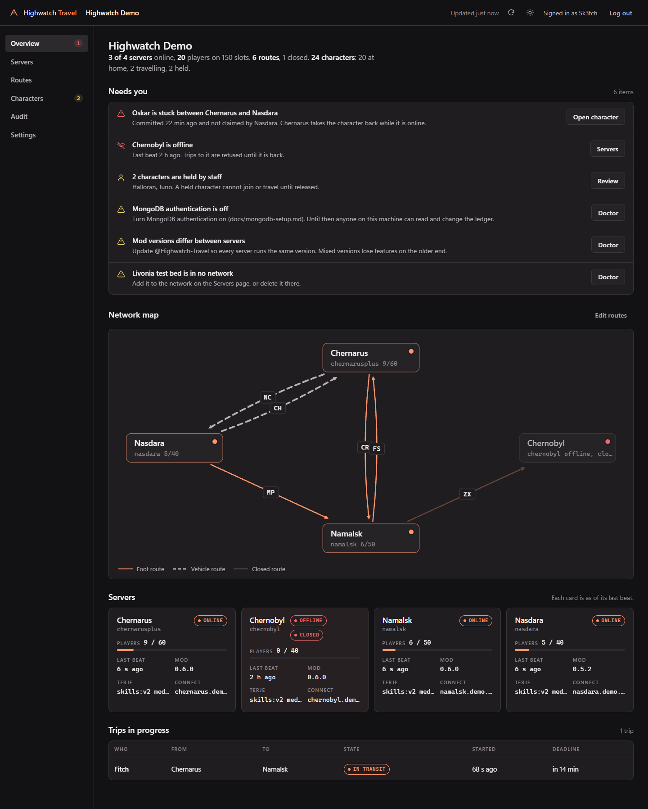
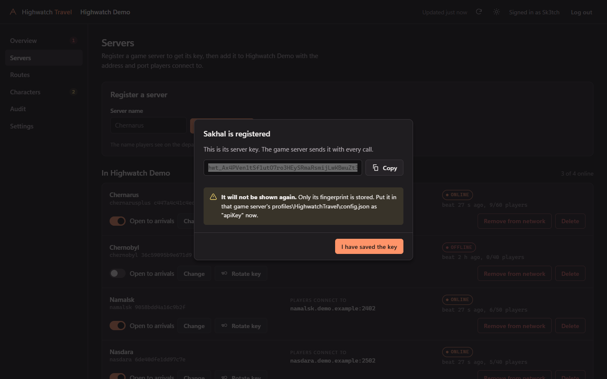
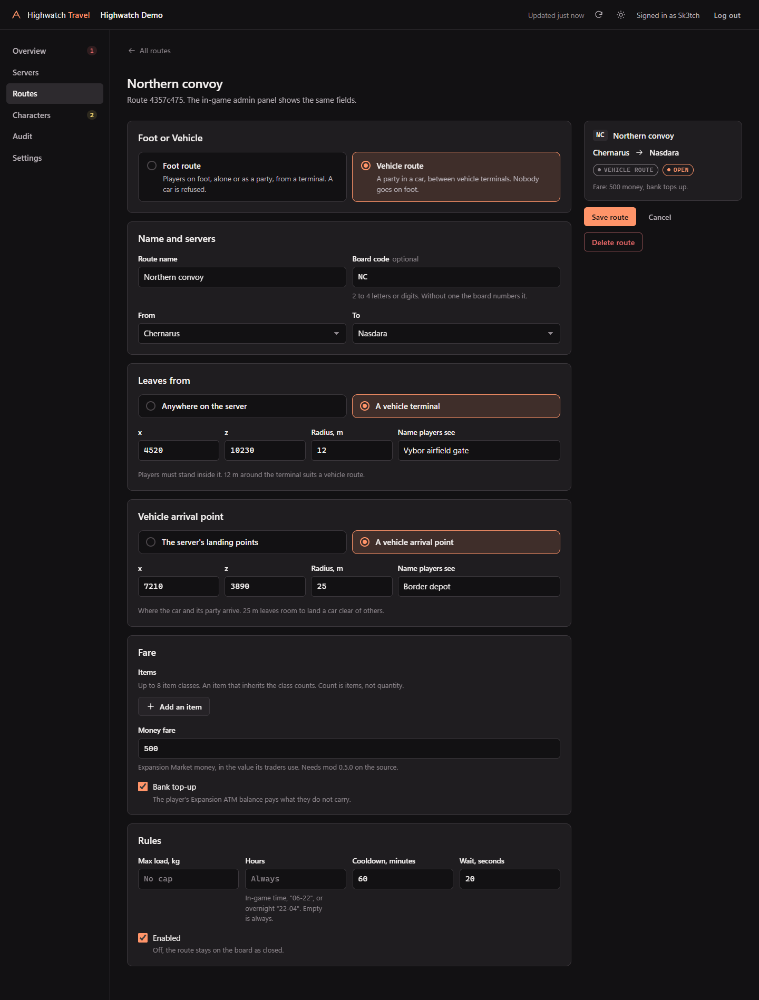
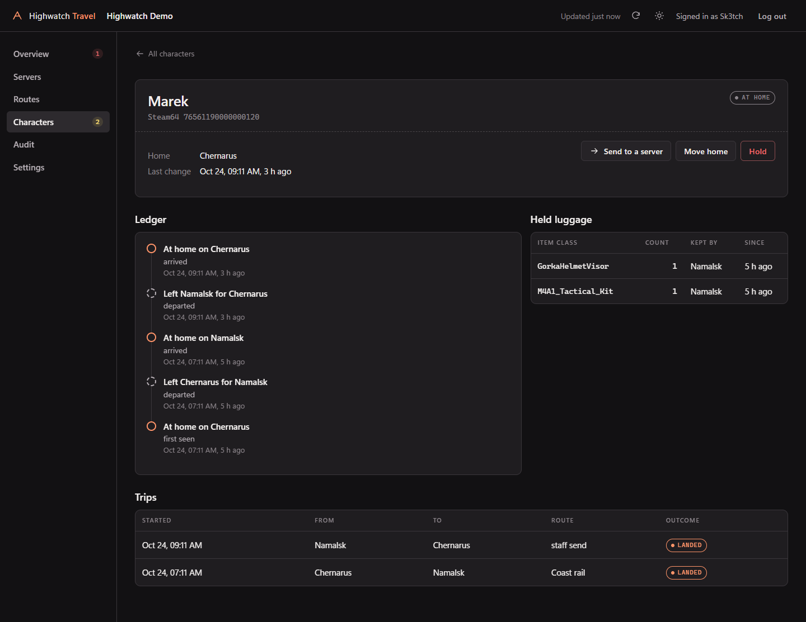
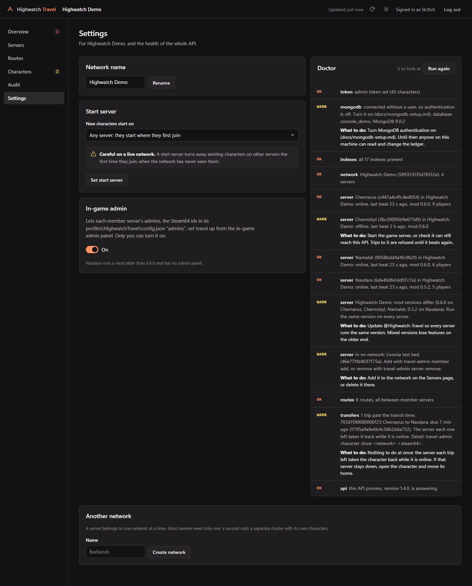
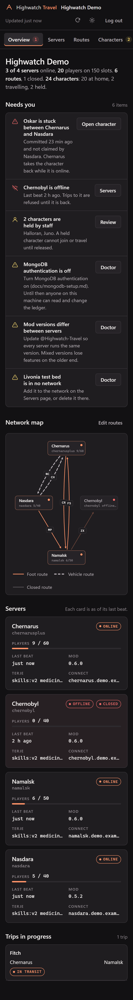

# The Travel console

The Travel API serves a web console at `/console/`. It is how you run the network from a browser: servers and their
keys, routes, characters, the audit of the in-game admin panels, and the doctor. It is the same owner API that
`travel-admin` and your scripts use ([api.md](api.md)), with a page in front of it.



## Open it

| Where you are | Open |
|---|---|
| On the API's own machine | http://127.0.0.1:6070/console/ (or the port in `TRAVEL_PORT`) |
| Anywhere else | https://travel.example.com/console/, through the HTTPS proxy from the README |

The console binds where the API binds. With the default `TRAVEL_HOST=127.0.0.1` it is reachable from the API's own
machine and through your proxy, and from nowhere else. Never reach it over plain HTTP across a network: the admin
token would travel unencrypted. When there is no proxy, an SSH tunnel to 127.0.0.1 works:
`ssh -L 6070:127.0.0.1:6070 you@the-api-machine`, then open http://127.0.0.1:6070/console/ on your own machine.

`TRAVEL_CONSOLE=0` in `.env` turns it off. The API and the mod are unchanged; `/console/` then answers 404.

## Sign in

Paste `TRAVEL_ADMIN_TOKEN` from the API's `.env`, and your name if you like. The name goes on every hold, release and
send you make, in the character's ledger, like the in-game admin panel's staff names.

- The token is kept in that browser tab's `sessionStorage` only. Closing the tab forgets it; **Log out** forgets it
  at once. It is sent only as an `Authorization` header, never in a URL, and the page has no form that could post it.
- A wrong token says so. Thirty wrong tokens from one address in ten minutes are refused for the rest of the ten
  minutes, the same limit as unknown server keys. The right token always passes.
- If the token changes while you are signed in, the next call is refused and the console asks for the new one.

## The pages

**Overview.** One card per server: online or offline with its last beat, players and slots, world, mod version,
Terje fingerprint, open or closed. The network map draws each route as a line between its two servers: a foot route
solid, a vehicle route wider and dashed, a closed route faded, each with its board code. Above them, **Needs you**
lists stuck trips, offline servers, held characters and the doctor's warnings, each with a way to deal with it.
The page refreshes itself every 15 seconds; the header says when it last did.

**Servers.** Register a server: its key is shown once, with a copy button. Put it in that game server's
`profiles\HighwatchTravel\config.json` as `apiKey`. Then add the server to the network with the address and port
players connect to. Each member can be changed, opened or closed to arrivals, removed from the network, or have its key
rotated (the old key stops at once, so the console asks first). Deleting a server that is still in a network is
refused with the API's reason.



**Routes.** The departures board, then the editor, in the in-game admin panel's words:

- **Foot or Vehicle** first. A vehicle route runs between vehicle terminals and takes a party in a car only.
- **From** and **To** are member servers.
- **Leaves from**: anywhere on the server, or a zone (x, z, radius and the name players see). The radius suggested is
  3 m for a foot terminal and 12 m for a vehicle terminal.
- **Lands at**: the destination's own landing points, or a zone. For a vehicle route it is the **Vehicle arrival
  point**, 25 m suggested.
- The fare: item lines (class and count), a money fare, and the bank top-up (the Expansion ATM balance pays what the
  player does not carry). Then max load, hours (`06-22`, or overnight `22-04`), cooldown, wait, and enabled.

The editor checks what the API checks before it sends, and shows the API's own reason on the field when it refuses.



**Characters.** Search by name or Steam64. A character's page shows its home and state, the ledger as a timeline, its
trips, and held luggage (items a destination had no class for, kept on the network). Hold, release (home, or to
another server), move home, and send to a server, each after a confirm. A travelling character can be none of these
until it lands or goes back.



**Audit.** What the member servers' admins changed from the in-game admin panel, newest first, with who and from
which server. Filter by server or by staff name or Steam64. Your own changes from the console are in each
character's ledger.

**Settings.** The network's name; the start server, with the warning that matters on a live network (a start
server turns away, on every other server, players the network has never seen, even ones who already have a character
there); the in-game admin switch; and the doctor, with what to do about each warning. A second network can be made
here too; the header then lets you switch between them.



## Light and dark, phone and keyboard

The console is dark by default, in the Highwatch Travel palette the in-game screens use; the sun button in the header
switches to a light theme (remembered in that browser). It works at phone width, and with the keyboard alone: every
control has a visible focus ring, every dialog traps focus and closes with Esc, and destructive dialogs start on
Cancel.



## Security

The console is static files from the `console/` folder, served by the API with no build step and nothing from
another origin. Its pages carry a strict `Content-Security-Policy` (its own scripts, styles and API calls only, no
inline script, no framing, no form posts), `X-Frame-Options: DENY`, `Referrer-Policy: no-referrer` and
`X-Content-Type-Options: nosniff`. Everything a game server or a player sends (names, labels) is put on the page as
text, never as markup.

## Try it with the demo network

`scripts/demo-seed.mjs` fills a throwaway database with a made-up network: Chernarus, Namalsk, Nasdara and Chernobyl,
foot and vehicle routes, characters at home, travelling, stuck and held, held luggage and audit rows. Every name, id
and address in it is invented, and it refuses any database without "demo" in its name.

```sh
TRAVEL_MONGO_URL=mongodb://127.0.0.1:27017/console_demo node scripts/demo-seed.mjs --beat
TRAVEL_MONGO_URL=mongodb://127.0.0.1:27017/console_demo TRAVEL_ADMIN_TOKEN=<npm run admin -- token> TRAVEL_PORT=6071 node src/server.mjs
```

`--beat` keeps three of the servers online while you look. Drop the database when you are done:
`TRAVEL_MONGO_URL=mongodb://127.0.0.1:27017/console_demo node scripts/demo-seed.mjs --drop`.
